# effect-coffee-shop

<p align="center">
  
</p>

A toy prototype showing the latest Alchemy, Effect, Cloudflare and Yielded working together:
an event-sourced coffee-ordering domain on Durable Objects, passkey auth, live order feeds, and a Foldkit UI
with an on-device LFM3 assistant (text and voice, WebGPU).

| Where                            | What                                        |
| -------------------------------- | ------------------------------------------- |
| `packages/coffee/domain`         | Aggregates, views, policy, Apis             |
| `packages/coffee/application`    | Service over the model for REST and MCP     |
| `packages/coffee/presentation/*` | REST, MCP, and shared action contracts      |
| `packages/coffee/auth`           | Yielded Auth passkeys, OAuth, D1 migrations |
| `packages/coffee/server`         | The Coffee Worker and the Sync order feeds  |
| `packages/ui-kit`, `apps/ui`     | Foldkit view primitives and the browser app |
| `apps/ui/src/features/assistant` | LFM3 and LFM3-Audio in a Web Worker         |
| `infra/alchemy`                  | Alchemy stack: Workers, D1, Secrets Store   |

```bash
bun install
bun run dev      # whole stack on Alchemy's Cloudflare emulation
bun run check    # typecheck, lint, format, tests, build
```

Passkeys need `APP_ORIGIN` and `MCP_SIGNING_KEY`; see `.env.example`.
