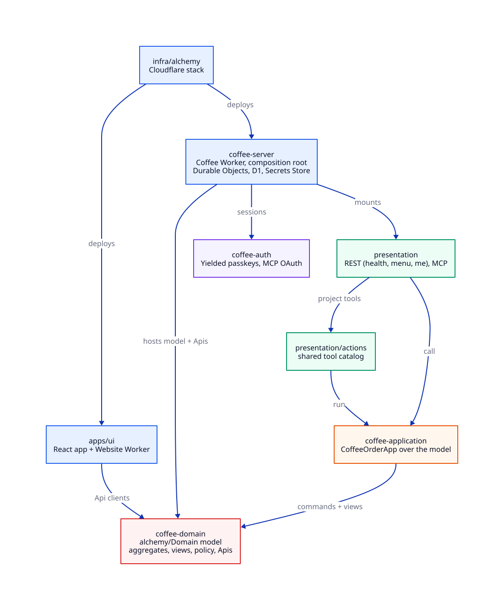
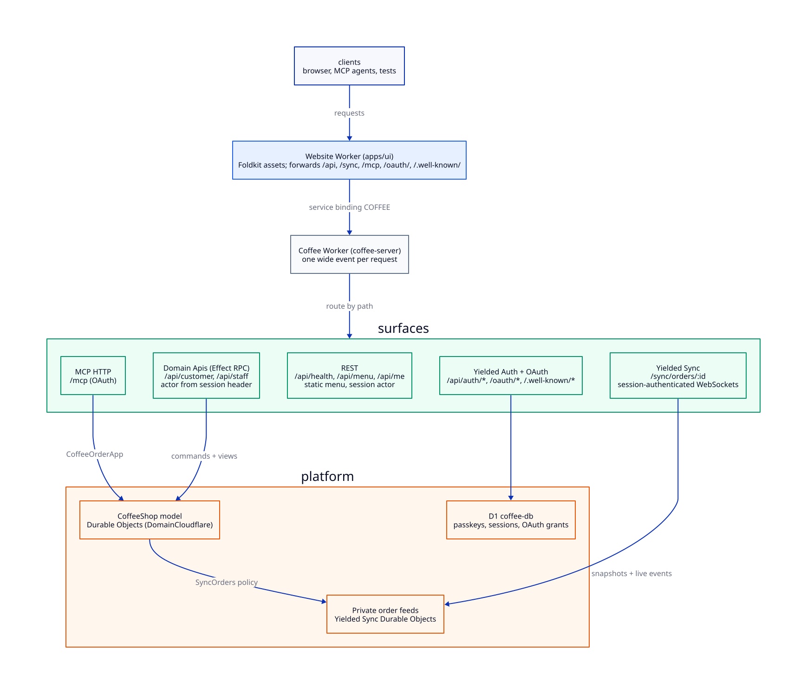
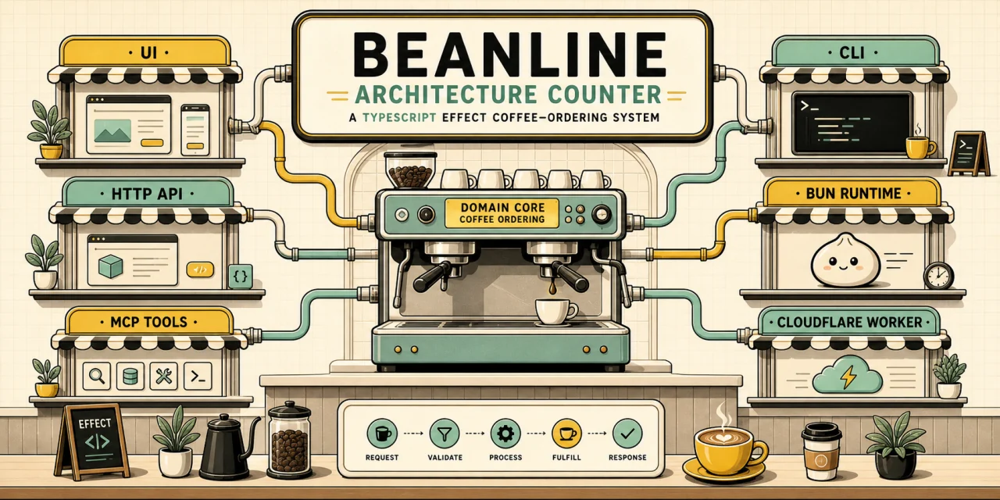
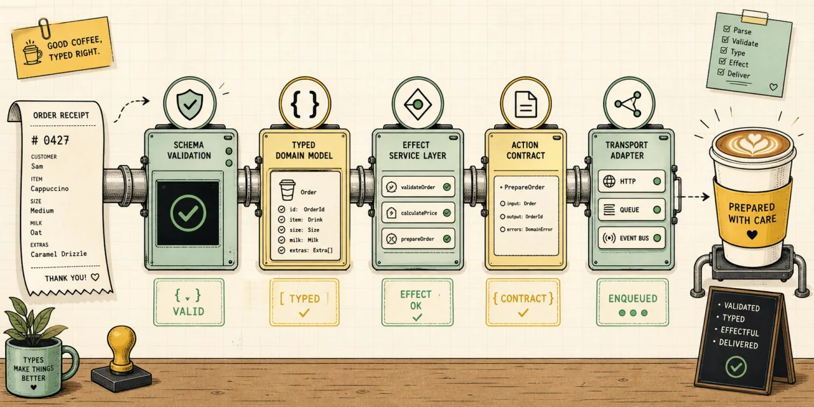
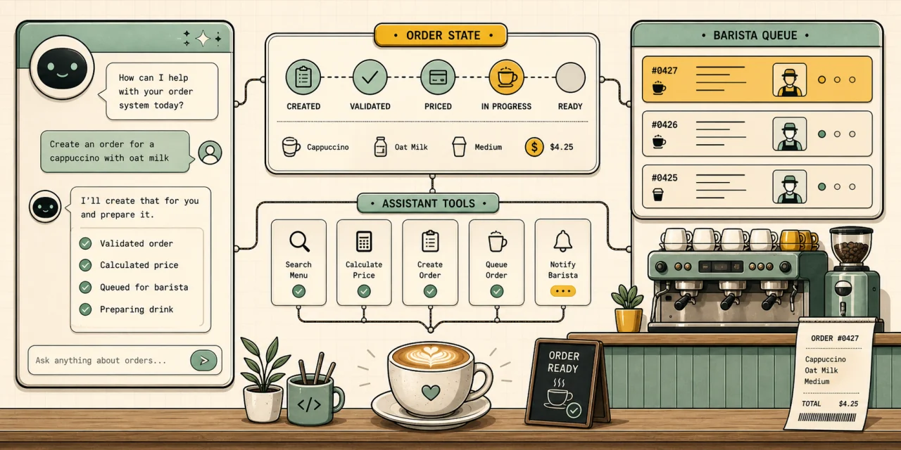
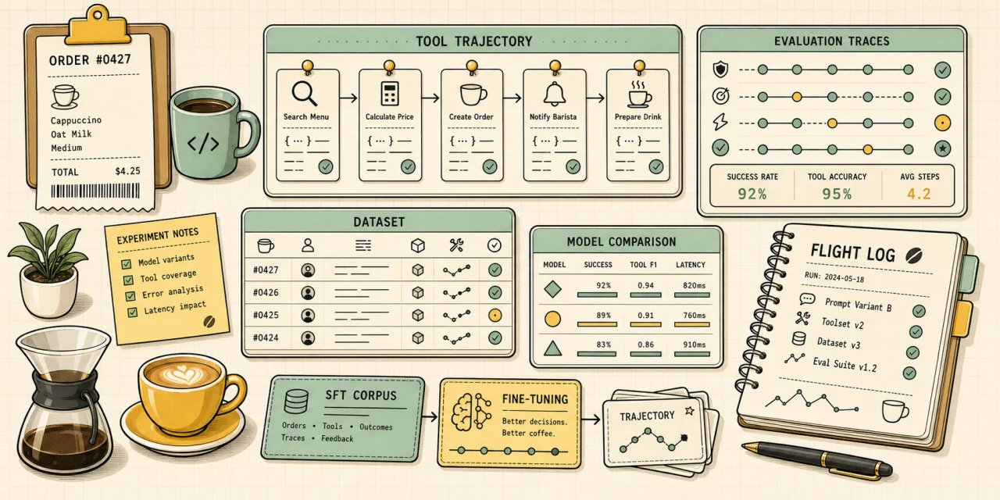

# effect-coffee-shop

Coffee-ordering app used to explore Domain-Driven Design and Onion Architecture
with TypeScript and Effect.

The Coffee domain is an event-sourced [`@alchemy.run/domain`](https://main.alchemy.run/domain/what-is-ddd/)
model: aggregates decide commands, views fold their events, and a policy starts a durable checkout saga.
One Cloudflare Worker hosts that model on Durable Objects and serves it to the
browser UI, remote MCP clients, and a small REST surface, with Yielded Auth
passkeys on D1.

## What This Repo Demonstrates

- An event-sourced domain written with `@alchemy.run/domain`: aggregates, views, a
  policy, a workflow saga, and two typed Apis, tested in memory with given/when/then stories.
- The same model running unchanged on `Domain.InMemory` in tests and on
  Cloudflare Durable Objects in production.
- One Coffee action catalog projected into Effect MCP tools over a thin
  application service.
- A Vite/React browser app that calls the domain Apis directly through
  generated Effect RPC clients.

> Alchemy core and the Cloudflare, AWS, and Domain packages are pinned together at
> `2.0.0-beta.84` in the workspace catalog. Providers use their own `@alchemy.run/*` packages.

## Quick Start

Use the Bun version from [`package.json`](./package.json):

```bash
bun install
```

Run the whole stack locally with Alchemy's Cloudflare emulation:

```bash
bun run dev
```

This runs `alchemy dev ./infra/alchemy/cloudflare.ts`: the Coffee Worker
(domain on Durable Objects, auth on D1), the Vite UI, and the Website Worker
that forwards `/api`, `/mcp`, `/oauth/`, and `/.well-known/` to the Coffee
Worker. Alchemy prints the local URLs.

For passkey sign-in, set `APP_ORIGIN` to the exact UI origin and an independent
`MCP_SIGNING_KEY` (at least 32 random bytes, base64url). `AUTH_SECRET` is
optional: without it Alchemy generates one and keeps it in Secrets Store.
Remote MCP additionally needs explicit `MCP_CLIENTS` registrations and an MCP
`2026-07-28` client. See [auth setup](./packages/coffee/auth/README.md).

## Architecture At A Glance

<details>
<summary>Architecture diagrams</summary>

The package layer view shows dependency direction. The runtime surface view shows how the
deployed Workers expose the domain Apis, REST, MCP, auth, and static assets.





Editable sources live in [`docs/architecture`](./docs/architecture).

</details>

| Layer                | Workspace                                                                        | Owns                                                                                     |
| -------------------- | -------------------------------------------------------------------------------- | ---------------------------------------------------------------------------------------- |
| Domain               | [`packages/coffee/domain`](./packages/coffee/domain)                             | The `@alchemy.run/domain` model: aggregates, views, policy, Apis, menu, and rejections.  |
| Application          | [`packages/coffee/application`](./packages/coffee/application)                   | `CoffeeOrderApp`, a thin service over the model for MCP/REST, plus contracts and actors. |
| Presentation         | [`packages/coffee/presentation`](./packages/coffee/presentation)                 | REST (health, menu, me) and MCP adapters.                                                |
| Presentation support | [`packages/coffee/presentation/actions`](./packages/coffee/presentation/actions) | Coffee tool names, descriptions, and schemas used by Effect MCP.                         |
| Auth                 | [`packages/coffee/auth`](./packages/coffee/auth)                                 | Yielded Auth passkeys, sessions, MCP OAuth, D1 migrations, customer/staff identities.    |
| Server               | [`packages/coffee/server`](./packages/coffee/server)                             | The Coffee Worker: hosts the model on Durable Objects and routes every backend path.     |
| HTTP routing         | [`packages/http-routing`](./packages/http-routing)                               | Wide-event request logging used by the Worker.                                           |
| UI kit               | [`packages/ui-kit`](./packages/ui-kit)                                           | Shared React primitives, fields, and theme controls.                                     |
| Browser app          | [`apps/ui`](./apps/ui)                                                           | Vite/React UI, Domain Api clients, passkey sign-in, and the Website Worker.              |
| Infrastructure       | [`infra/alchemy`](./infra/alchemy)                                               | The Alchemy stack that deploys both Workers, D1, and Secrets Store.                      |

## Why Coffee Actions Exists

[`coffee-domain`](./packages/coffee/domain) owns the business rules. The browser
UI calls its `CustomerApi` and `StaffApi` directly.
[`coffee-application`](./packages/coffee/application) adapts the same model for
the other surfaces: `CoffeeOrderApp` sends commands to aggregates, reads views,
and translates domain rejections into adapter errors.

[`coffee-actions`](./packages/coffee/presentation/actions) gives each MCP-callable Coffee capability
one stable name, description, and input/output schema.
[`coffee-mcp`](./packages/coffee/presentation/mcp) projects those contracts into Effect MCP tools,
resources, and prompts without duplicating business behavior.

It is not a second business layer. If the behavior changes, change the domain
model. If one surface needs a private helper, keep that helper in the surface
package. Add or change `coffee-actions` when an MCP tool needs a
protocol-neutral shape.

## Choose Your Path

| Goal                                   | Start Here                                                                                     |
| -------------------------------------- | ---------------------------------------------------------------------------------------------- |
| Add or change Coffee business behavior | [`packages/coffee/domain`](./packages/coffee/domain)                                           |
| Change the Worker, routing, or session | [`packages/coffee/server`](./packages/coffee/server)                                           |
| Change deployment                      | [`infra/alchemy/README.md`](./infra/alchemy/README.md)                                         |
| Work on the browser UI                 | [`apps/ui/README.md`](./apps/ui/README.md)                                                     |
| Understand package boundaries          | [`packages/README.md`](./packages/README.md)                                                   |
| Add a shared tool/capability action    | [`packages/coffee/presentation/actions`](./packages/coffee/presentation/actions)               |
| Change REST or MCP surfaces            | [`packages/coffee/presentation`](./packages/coffee/presentation)                               |
| Change passkey auth                    | [`packages/coffee/auth`](./packages/coffee/auth)                                               |
| Read the SFT experiment notes          | [`docs/beanline-prime-intellect-flight-log.md`](./docs/beanline-prime-intellect-flight-log.md) |

## Common Commands

| Command                   | Purpose                                                            |
| ------------------------- | ------------------------------------------------------------------ |
| `bun run dev`             | Run the full stack locally with Alchemy (Workers, Vite, D1, DOs).  |
| `bun run storybook`       | Run the UI Storybook dev server.                                   |
| `bun run build-storybook` | Build the UI Storybook static site.                                |
| `bun run test`            | Run every workspace's tests through Turborepo.                     |
| `bun run cf:test`         | Deploy the stack locally and run its smoke and end-to-end tests.   |
| `bun run check`           | Run typecheck, lint, format check, tests, custom lint, and Fallow. |
| `bun run check:affected`  | Run the affected workspace gate against the current branch.        |
| `bun run build`           | Build distributable workspace artifacts through Turborepo.         |

Workspace-specific gate:

```bash
bun run --cwd apps/ui check
```

Tests live next to what they exercise: domain stories in
[`packages/coffee/domain/test`](./packages/coffee/domain/test), the Apis and
`CoffeeOrderApp` over `Domain.InMemory` in
[`packages/coffee/server/test`](./packages/coffee/server/test), passkeys on D1
in [`packages/coffee/auth`](./packages/coffee/auth), and the deployed stack in
[`infra/alchemy/cloudflare.test.ts`](./infra/alchemy/cloudflare.test.ts).

Hook checks:

```bash
bun run hooks:run:pre-commit
bun run hooks:run:pre-push
```

## CI

CI pins Node.js via `.node-version` alongside Bun: Vitest and Cloudflare tooling
use Node and require modern JavaScript resource-management syntax.
CI runs three jobs in parallel on every PR and push to `main`:

| Command              | Coverage                                                                                                  |
| -------------------- | --------------------------------------------------------------------------------------------------------- |
| `bun run ci:static`  | Native TypeScript 7 + Effect diagnostics, type-aware Oxlint, Oxfmt, and infrastructure typechecking.      |
| `bun run ci:backend` | All package tests (domain stories, Apis over `Domain.InMemory`, auth on D1) plus the local Alchemy stack. |
| `bun run ci:ui`      | Storybook browser tests in light/dark themes and the production Vite build.                               |

For local browser tests, first run `bunx --no-install playwright install --with-deps --only-shell chromium`
from `apps/ui`. The custom `lintcn` and Fallow audits remain available through `bun run check`.

CI restores Turborepo task caches and cancels superseded PR runs. Shared lint
configuration and dependency typechecks participate in cache invalidation.
Dependencies are installed from the frozen lockfile, and the Effect compiler
patch runs on every install. Keep TypeScript and `@effect/tsgo` pinned to a
[supported combination](https://github.com/Effect-TS/tsgo#supported-package-versions).
The compiler executable is named `tsc` in TypeScript 7; the old native-preview
`tsgo` package is no longer needed.

## Local Configuration

The root install covers all workspaces, uses the root dependency catalog, and
patches TypeScript with Effect tsgo diagnostics, and installs local Git hooks
outside CI.

Environment examples live in:

- [`.env.example`](./.env.example): application, auth, observability,
  and deployment variables.
- [`.env.alchemy.example`](./.env.alchemy.example): Alchemy state and provider
  variables.

## Deployment

Infrastructure is managed with Alchemy.

```bash
bun run cf:profile:edit --profile default
bun run infra:dev --profile default
# Choose the deployment stage.
export ALCHEMY_STAGE=dev_yourname
bun run infra:plan --profile default
bun run infra:deploy --profile default
```

Cloudflare is the only deploy target. [`infra/alchemy/alchemy.run.ts`](./infra/alchemy/alchemy.run.ts)
re-exports [`cloudflare.ts`](./infra/alchemy/cloudflare.ts), so the `infra:*` and
`cf:*` scripts deploy the same stack: the Coffee Worker (Durable Objects for the
domain model, D1 for auth, Secrets Store for `AUTH_SECRET`) and the `onion`
Vite website whose Worker forwards backend paths to it over a service binding.
The Coffee Worker reads `APP_ORIGIN`, `MCP_SIGNING_KEY`, `MCP_CLIENTS`,
`COFFEE_STAFF_USER_IDS`, and the optional `AUTH_SECRET` at deploy time. See
[`infra/alchemy`](./infra/alchemy/README.md).

## Project Images

| Beanline architecture counter                                                                    | Typed order pipeline                                                           |
| ------------------------------------------------------------------------------------------------ | ------------------------------------------------------------------------------ |
|  |  |

| Assistant at the bar                                                           | Flight log SFT workbench                                                               |
| ------------------------------------------------------------------------------ | -------------------------------------------------------------------------------------- |
|  |  |

## Notes For Contributors

- Root tasks are run by Turborepo.
- `check:affected`, `build:affected`, and `test:affected` use Turborepo's
  affected mode against the current branch.
- Installs automatically apply the Effect tsgo compiler patch. `bun run tsgo:patch`
  reapplies it; `bun run tsgo:unpatch` restores the stock native TypeScript binary.
  Typechecks use native TypeScript 7 through `tsc`, with Effect diagnostics enabled.
- Decode external input at the boundary, preferably with `effect/Schema`, then
  pass typed domain values inward.
