# effect-coffee-shop

<p align="center">
  
</p>

An event-sourced coffee shop on Effect, Alchemy, Cloudflare and Yielded: one domain model served
over Effect RPC, REST and MCP, passkey sign-in, live order feeds, and a Foldkit UI with an on-device
LFM3 assistant.

```bash
bun install
bun run dev    # the whole stack on Alchemy's Cloudflare emulation
bun run check  # lint + types, format, tests, build, Fallow
```

> [!NOTE]
> Passkeys need `APP_ORIGIN` and `MCP_SIGNING_KEY`; start from `.env.example`.

<details>
<summary>What lives where</summary>

| Where                            | What                                        |
| -------------------------------- | ------------------------------------------- |
| `packages/coffee/domain`         | Aggregates, views, policy, Apis             |
| `packages/coffee/application`    | Menu, pricing and order reads for MCP       |
| `packages/coffee/presentation/*` | REST, MCP, and shared action contracts      |
| `packages/coffee/routes`         | Backend paths, defined once                 |
| `packages/coffee/auth`           | Yielded Auth passkeys, OAuth, D1 migrations |
| `packages/coffee/server`         | The Coffee Worker and the model's host      |
| `packages/ui-kit`, `apps/ui`     | Foldkit view primitives and the browser app |
| `apps/ui/src/features/assistant` | LFM3 and LFM3-Audio in a Web Worker         |
| `infra/alchemy`                  | Alchemy stack: Workers, D1, Secrets Store   |

How the layers fit: [package layers](./docs/architecture/package-layers.svg). How a request reaches
the Worker: [backend runtime surfaces](./docs/architecture/backend-runtime-surfaces.svg).

</details>
