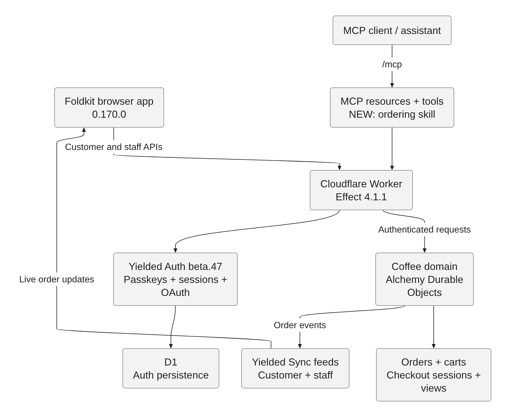
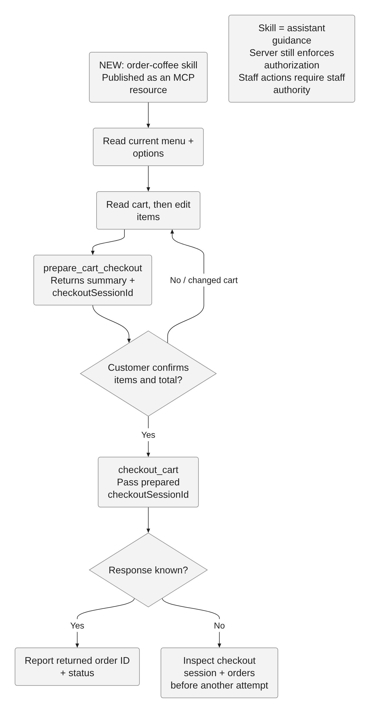
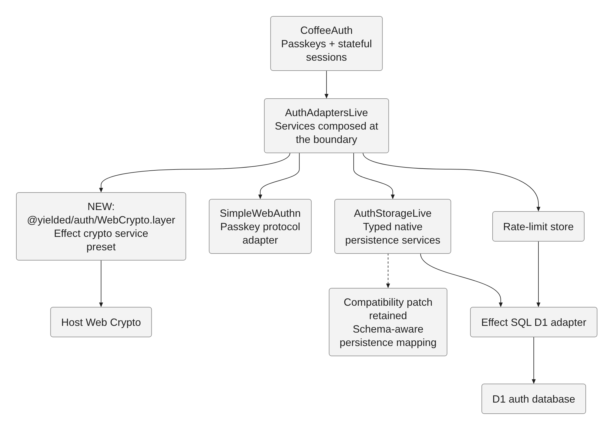

# PR diagrams

These diagrams describe the dependency refresh and the existing system it runs within. Labels marked **NEW** identify the adopted behavior. The checkout diagram describes assistant guidance, not a new server-side confirmation mechanism.

| System                                                      | Checkout guidance                                         | Auth composition                                         |
| ----------------------------------------------------------- | --------------------------------------------------------- | -------------------------------------------------------- |
|  |  |  |

Sources are Mermaid text in `dependency-refresh/*.mmd`, rendered by [Pele](https://github.com/obsidianmd/pele) 1.13.0 to SVG. PNGs are captured from those SVGs in Chrome for reliable PR rendering. Sources, SVGs, and PNGs are committed together.

Regenerate from the repository root with Node 26 and Chrome installed:

```sh
mkdir -p .context/diagram-tools
printf '{"private":true,"type":"module"}\n' > .context/diagram-tools/package.json
npm install --prefix .context/diagram-tools --ignore-scripts --no-audit --no-fund pele@1.13.0 playwright-core@1.64.1
node docs/diagrams/render.mjs
```

Set `CHROME` if Chrome is not at `/usr/bin/google-chrome`. Rendering tools live only in `.context`; they are not application dependencies. Review PNGs after editing source diagrams, then use commit-pinned GitHub raw URLs in the PR image table.
