# Effect Turbo cache

A private, single-team [Turborepo remote cache](https://turborepo.dev/docs/core-concepts/remote-caching).
One Effect service speaks the artifact protocol; Alchemy supplies the storage bindings, permissions
and hosting, on Cloudflare or AWS.



```sh
bun run cache:test                  # local emulator, driven by the real Turbo CLI
bun run cache:deploy:cloudflare     # or cache:deploy:aws, after cache:env validates config
```

> [!NOTE]
> Turbo signs artifacts on the client and the cache never sees the signing key. Both laptops must
> share one signing key: rotating it makes every existing remote artifact unusable.

<details>
<summary>Targets and protocol</summary>

| Target     | API                             | Storage | Deployment state                    |
| ---------- | ------------------------------- | ------- | ----------------------------------- |
| Cloudflare | Worker                          | R2      | Alchemy's Cloudflare state service  |
| AWS        | ECS Fargate behind an HTTPS ALB | S3      | Alchemy's encrypted S3 state bucket |

Cloudflare is the default: no always-running container or load balancer. AWS supports larger HTTP
bodies, where Lambda's synchronous payload limit would be unsuitable for build artifacts. The domain
service has no provider dependency, so another cloud needs an `ArtifactStore` adapter and a runtime
entrypoint. The two targets use separate buckets, without cross-cloud replication.

- `PUT`, `GET`, and `HEAD /v8/artifacts/:hash`, cache status, analytics events, and authenticated
  OPTIONS preflight. Unversioned artifact paths also work.
- Bearer authentication, one configured team (`slug` or `teamId`), separate read and write tokens,
  and constant-time token digest comparison. Events are accepted and discarded; there is no
  analytics database.
- Uploads require an accurate `Content-Length`. The default limit is **64 MiB of compressed artifact
  data**, configurable up to 90 MiB. Oversized uploads fail with 413 before any storage operation;
  Turbo still builds locally.
- Uploads use sequential **5 MiB multipart chunks**, avoiding whole-artifact buffering. Budget
  several MiB per concurrent upload. Failed or interrupted uploads are aborted; a failed overwrite
  leaves the previous object intact.
- Signature, duration, SHA, and dirty-hash metadata are attached when multipart upload starts. GET
  and HEAD return that metadata. HEAD returns object length; Cloudflare may use chunked transfer for
  streaming GET responses.
- Artifacts expire after 14 days. Bucket lifecycle rules remove abandoned multipart uploads after one
  day; lifecycle cleanup is asynchronous.
- `/health` is an unauthenticated liveness endpoint. Storage errors return 503; missing artifacts
  return 404. Authentication tokens and artifact bytes stay out of application logs.

</details>

<details>
<summary>Secrets across two laptops</summary>

Use **Varlock + one shared vault**. Varlock 1.25.0 is pinned in this repository and
validates/injects configuration before a process starts; it is not part of request handling. The
checked-in schemas contain names, validation, and public defaults; secret values belong in your
chosen provider. `.env.local` files are gitignored.

There are three independent random secrets:

| Secret                             | Consumers                                               |
| ---------------------------------- | ------------------------------------------------------- |
| `CACHE_WRITE_TOKEN`                | Deployed API; trusted clients use it as `TURBO_TOKEN`   |
| `CACHE_READ_TOKEN`                 | Deployed API; read-only clients use it as `TURBO_TOKEN` |
| `TURBO_REMOTE_CACHE_SIGNATURE_KEY` | Turbo clients only                                      |

Generate each independently with at least 32 random bytes, encoded as hex or base64url, and save them
directly in the vault. Do not regenerate them separately on each laptop. A laptop's local keychain
alone does not provide shared storage.

If you use 1Password, Varlock supports desktop-app/biometric authentication on each laptop. Add this
to an appropriate local override, using your actual vault references (the plugin versions are
examples):

```dotenv
# @plugin(@varlock/1password-plugin@2.0.4)
# @initOp(allowAppAuth=true)
# ---
TURBO_TOKEN=op(op://YOUR_VAULT/turbo-cache/write-token)
TURBO_REMOTE_CACHE_SIGNATURE_KEY=op(op://YOUR_VAULT/turbo-cache/signing-key)
```

Use corresponding `op(...)` references for deployment tokens. A different vault can supply the same
schema fields without changing the Effect service. Prefer short-lived AWS SSO credentials for local
deployment; the ECS task receives S3 permissions through Alchemy's IAM bindings and tokens through
Secrets Manager. Cloudflare receives the tokens as Worker secrets. [Varlock's 1Password
integration](https://varlock.dev/plugins/1password/) fits the existing Bun workflow and supports both
desktop and service-account auth.

</details>

<details>
<summary>Deploy and destroy</summary>

Set deployment configuration through the shell or `infra/turbo-cache/.env.local`, preferably using
vault references. `bun run cache:env` validates it with sensitive values redacted.

For Cloudflare, provide `CLOUDFLARE_ACCOUNT_ID` and an Alchemy-authenticated profile or a token
permitted to manage Workers, R2, Worker secrets, and the Alchemy state service. Initial remote-state
setup also uses Cloudflare Secrets Store. Follow Alchemy's `configure`/login flow for the account
instead of copying one laptop's local Alchemy directory to the other.

For AWS, authenticate an AWS profile, select `AWS_REGION`, and set `CACHE_DOMAIN` to a hostname in a
public Route 53 hosted zone in that account. Alchemy provisions the certificate, DNS, ALB, ECS
cluster/service, ECR image, private encrypted S3 bucket, and Secrets Manager secrets. Docker is
required to build the container. This stack uses the account's default VPC and subnets, which must
exist and support outbound image pulls. ALB and Fargate incur ongoing charges while deployed.

Deployment scripts use the same explicit `prod` stage from either laptop, so both must target the
same account, region, profile, and stage. Treat remote state as sensitive and serialize deployments to
a given stage; remote storage alone is not a reason to assume concurrent deployments are safe. The
cache's state storage is separate from the expiring artifact bucket.

`bun run cache:destroy:cloudflare` or `bun run cache:destroy:aws` removes a deployment. These are
destructive; bucket retention and cloud deletion rules may require clearing cache objects first.

</details>

<details>
<summary>Tests and code layout</summary>

```sh
bun run --cwd packages/turbo-cache test     # unit tests, milliseconds
bun run cache:test                          # integration, needs no cloud credentials
bun run --cwd infra/turbo-cache lint
```

`infra/turbo-cache` is a workspace (`@effect-coffee-shop/infra-turbo-cache`), so `cache:test` is a
filtered alias for its `test:integration` task and replays from the cache when neither the deployment
code nor `packages/turbo-cache` changed. `test:integration` is in `check:release`, so a pushed `v*`
tag runs it and commits do not.

The unit suite covers authentication, multipart boundaries, interruption and cleanup, storage
failures, redacted config errors, and S3 operation mapping. The integration suite deploys a real
local Alchemy Worker/R2 emulator, exercises GET/HEAD/PUT and preflight, and runs the installed Turbo
CLI against it: it restores a signed, incompressible 9 MiB artifact after deleting the local cache
and verifies that the build script ran only once. Local tests are not a production latency benchmark.
AWS has typechecked infrastructure and an S3 adapter covered by unit tests; a live AWS deployment and
smoke test are still required before trusting its endpoint.

`packages/turbo-cache` holds the protocol service and its `ArtifactStore` port; `infra/turbo-cache`
holds `cloudflare.ts`, `aws.ts`, and the ECS service definition.

</details>

<details>
<summary>Connect clients</summary>

Put the deployment's HTTPS URL and matching team into `config/turbo-cache/.env.local`, along with
references for `TURBO_TOKEN` and `TURBO_REMOTE_CACHE_SIGNATURE_KEY`. Validate or run a command through
Varlock:

```sh
bunx varlock load --path config/turbo-cache/
bun run cache:run bun run lint
```

Each laptop keeps its local Turbo cache. A local miss is fetched from the shared remote cache, so it
can reuse work from the other laptop immediately.

</details>
