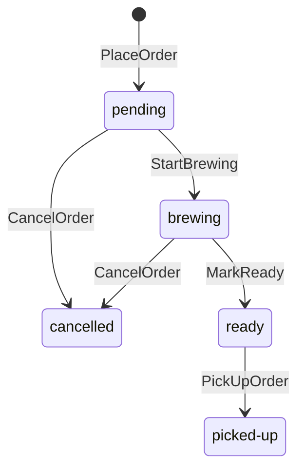
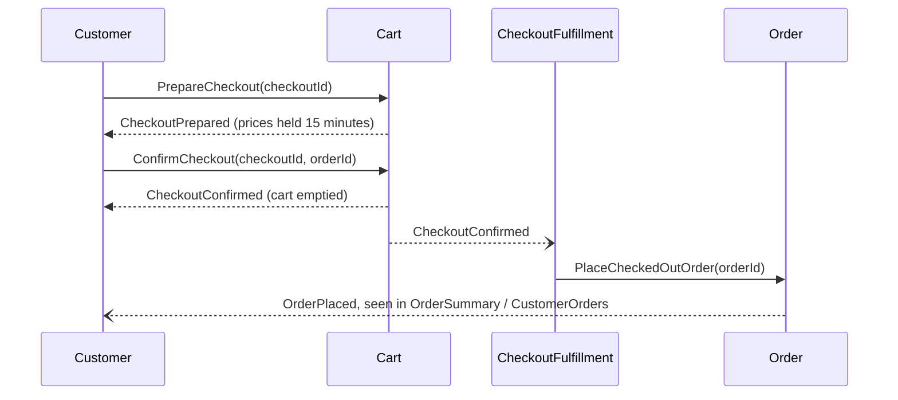

# Coffee Domain

`@effect-coffee-shop/coffee-domain` is the coffee shop as an
[`@alchemy.run/domain`](https://main.alchemy.run/domain/what-is-ddd/) model: commands that aggregates
decide, events they record, views that fold those events into what people read, and a policy that
reacts. It is pure: it imports only `@alchemy.run/domain` and `effect`. The same model runs in memory
for tests and on Cloudflare Durable Objects in production, hosted by
[`coffee-server`](../server).

Files follow the alchemy-domain layout: one building block per file, named `<Noun>.<kind>.ts`,
with folders as subdomains. Import them by path, e.g.
`@effect-coffee-shop/coffee-domain/Order/Order.aggregate`.

> Alchemy core and the Cloudflare, AWS, and Domain packages are pinned together at
> `2.0.0-beta.84` in the workspace catalog. Providers use their own `@alchemy.run/*` packages.

## The model

| Building block | Files                                                                                                                          | What it does                                                                                                                              |
| -------------- | ------------------------------------------------------------------------------------------------------------------------------ | ----------------------------------------------------------------------------------------------------------------------------------------- |
| Aggregate      | [`Order/Order.aggregate.ts`](src/Order/Order.aggregate.ts)                                                                     | One ticket, keyed by `OrderId`: placed once, then moved along its lifecycle by staff.                                                     |
| Aggregate      | [`Cart/Cart.aggregate.ts`](src/Cart/Cart.aggregate.ts)                                                                         | One person's cart, keyed by `CustomerId`: its lines and the checkout awaiting confirmation. Confirming empties the cart in the same step. |
| Aggregate      | [`Customer/Customer.aggregate.ts`](src/Customer/Customer.aggregate.ts), [`Shop/Shop.aggregate.ts`](src/Shop/Shop.aggregate.ts) | Keys only: views about one customer, or the whole shop, are keyed by them. They decide nothing yet.                                       |
| View           | [`Order/OrderSummary.view.ts`](src/Order/OrderSummary.view.ts)                                                                 | One ticket as people read it. Staff read any; a customer only their own.                                                                  |
| View           | [`Order/CustomerOrders.view.ts`](src/Order/CustomerOrders.view.ts)                                                             | Every order one customer placed, folded from `OrderSummary`.                                                                              |
| View           | [`Order/OrderQueue.view.ts`](src/Order/OrderQueue.view.ts)                                                                     | The baristas' queue: open orders plus the 200 most recent finished ones. Staff only.                                                      |
| Policy         | [`Cart/CheckoutFulfillment.policy.ts`](src/Cart/CheckoutFulfillment.policy.ts)                                                 | Whenever a checkout is confirmed, start its fulfillment saga.                                                                             |
| Saga           | [`Cart/FulfillCheckout.saga.ts`](src/Cart/FulfillCheckout.saga.ts)                                                             | Place the confirmed order in a durable workflow, keyed by order id.                                                                       |
| Api            | [`CustomerApi.api.ts`](src/CustomerApi.api.ts), [`StaffApi.api.ts`](src/StaffApi.api.ts)                                       | What each audience may send and read.                                                                                                     |
| Model          | [`CoffeeShop.model.ts`](src/CoffeeShop.model.ts)                                                                               | Everything hosted together, plus policy and saga implementations as one Layer.                                                            |

Commands live in `<Command>.command.ts` with the events they record and the rejections only they
return. Shared rejections have their own `*.rejection.ts` files.

| Aggregate | Commands                                                                                                    | Events                                                                                                        |
| --------- | ----------------------------------------------------------------------------------------------------------- | ------------------------------------------------------------------------------------------------------------- |
| `Order`   | `PlaceOrder`, `PlaceCheckedOutOrder` (saga only), `StartBrewing`, `MarkReady`, `PickUpOrder`, `CancelOrder` | `OrderPlaced`, `BrewingStarted`, `OrderReady`, `OrderPickedUp`, `OrderCancelled`                              |
| `Cart`    | `AddCartItem`, `UpdateCartItem`, `RemoveCartItem`, `ClearCart`, `PrepareCheckout`, `ConfirmCheckout`        | `CartItemAdded`, `CartItemUpdated`, `CartItemRemoved`, `CartCleared`, `CheckoutPrepared`, `CheckoutConfirmed` |

Rejections carry their evidence: `DrinkNotFound { drinkId }`, `InvalidOrder { message }`,
`InvalidStatusTransition { orderId, from, to }`, `OrderNotFound`, `AlreadyPlaced`, `StaffOnly`,
`NotYourOrder`, `NotYourCart`, `CartItemNotFound`, `CheckoutNotFound`, `CheckoutExpired`.

## Order lifecycle

Staff move a ticket through these states. `decide` in `Order.aggregate.ts` refuses every other
move with `InvalidStatusTransition`, including repeated, skipped and backward steps.



## Checkout



Emptying the cart and confirming happen in one `Cart` commit, so a confirmed cart is never
ordered twice. After the commit, the policy starts `FulfillCheckout`, a saga keyed by order id. Its
`PlaceCheckedOutOrder` activity journals completion and uses workflow-derived command ids, so
redelivery or replay does not place another order. The in-memory platform runs the same workflow
in stories; Cloudflare hosts it on `DomainCloudflare.DurableObjects`' built-in workflow engine.
`PlaceCheckedOutOrder` is idempotent, because policies run at least once.

## Who may do what

`Session` ([`Session.middleware.ts`](src/Session.middleware.ts)) authenticates a request and
provides `CurrentActor` ([`CurrentActor.context.ts`](src/CurrentActor.context.ts)): a `customer`,
`staff`, or `system` [`Actor`](src/Actor.ts). Each command's `decide` and each view's `validate`
authorizes against it:

- Anyone signed in may place orders and use their own cart (a cart is keyed by its owner).
- Only staff (and the system) may move tickets or read the queue.
- Customers read only their own tickets and order lists.

Staff authority comes from deployment configuration (`COFFEE_STAFF_USER_IDS`), never from the
session.

## Values

[`Menu/`](src/Menu) holds the static menu and pricing. [`Menu/OrderItem.ts`](src/Menu/OrderItem.ts)
prices a `DrinkSelection` (menu choices with defaults) as pure functions returning `Result`, so
`decide` can price a request and reject it in the same step. [`Money.ts`](src/Money.ts) keeps
exact cents. Ids (`OrderId`, `CartItemId`, `CheckoutId`) are prefixed, time-ordered strings made by
whoever sends the creating command ([`TypedId.ts`](src/TypedId.ts)), so a retried command
addresses the same instance.

## Tests

[`test/CoffeeShop.story.test.ts`](test/CoffeeShop.story.test.ts) specifies the model with stories:
given events, when a command is sent, then the events, replies, rejections and view states that
follow. The policy runs for real. Unit tests cover pricing, money, the menu and the lifecycle
table.

```bash
bun run --cwd packages/coffee/domain test
bun run --cwd packages/coffee/domain typecheck
bun run --cwd packages/coffee/domain lint
```

The server's [`CoffeeApis.test.ts`](../server/test/CoffeeApis.test.ts) drives the Apis over the
in-memory platform. The Alchemy smoke test (`bun run cf:test`) runs the model on locally emulated
Durable Objects.
