# Coffee Server

The Coffee Worker: serves every backend path over the `coffee-domain` model, wherever it is hosted.
`src/CoffeeServer.ts` is the program and names no provider.

`src/hosts/` picks where it runs, and `Routes.ts` holds the ordered table of which surface serves a
path and whether that surface needs auth or refuses bearer tokens.

Hosts and paths

`hosts/edge/` is where requests are served (Cloudflare, with auth on D1 and Secrets Store),
`hosts/model/` is where the domain model runs (`DurableObjects.ts` or `RivetDocker.ts`), and each
Worker combines one of each (`CoffeeWorker.ts`, `CoffeeWorkerRivet.ts`). Backend prefixes come from
`coffee-routes`.

| Path                                        | Served by                                                    |
| ------------------------------------------- | ------------------------------------------------------------ |
| `/api/customer`, `/api/staff`               | Domain Apis behind the session; live watches over WebSockets |
| `/api/rest/customer`, `/api/rest/staff`     | The same Apis as REST, OpenAPI                               |
| `/api/auth/*`, `/oauth/*`, `/.well-known/*` | Yielded Auth                                                 |
| `/api/health`, `/api/menu`, `/api/me`       | REST                                                         |
| `/mcp`                                      | MCP tools, generated from the Apis                           |

Tests run the same model on `Domain.InMemory`; see
[`test/CoffeeApis.test.ts`](./test/CoffeeApis.test.ts) for the Apis and `bun run cf:test` for the
stack on emulated Durable Objects.

